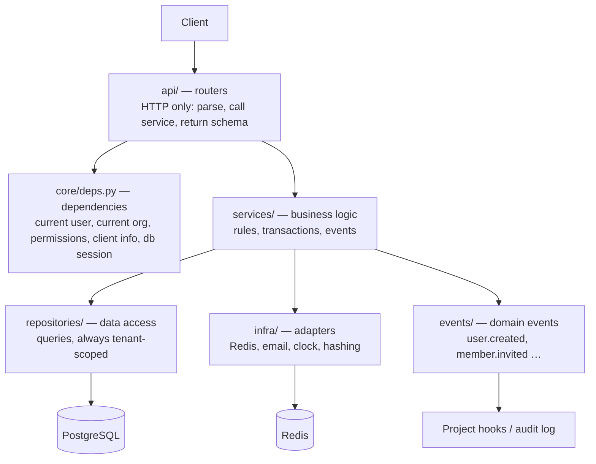
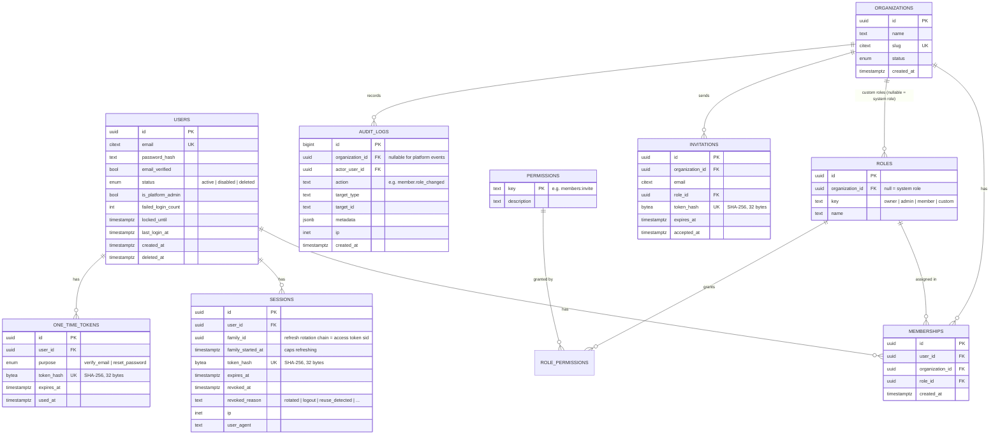

# Architecture

This is the **target** architecture. The current code (pre-roadmap) does not match it yet;
`docs/ROADMAP.md` moves it here step by step. When code and this document disagree, either the
code is wrong or this document must be updated in the same pull request.

---

## 1. Stack

| Concern | Choice | Why (details in `docs/adr/`) |
| --- | --- | --- |
| Language | Python 3.12+ | Current stable, good typing support |
| Web framework | FastAPI | Typed, async, OpenAPI out of the box |
| Database | PostgreSQL 16 | Constraints, enums, JSONB, row-level security (ADR-0002) |
| ORM / migrations | SQLAlchemy 2.0 (async) + Alembic | Standard, typed, async (ADR-0005) |
| DB driver | `asyncpg` | Fastest mature async Postgres driver |
| Cache / rate limits | Redis 7 via `redis.asyncio` | Shared state across instances |
| Password hashing | Argon2id (`argon2-cffi`) | OWASP's first recommendation (ADR-0006) |
| Tokens | `PyJWT` | Maintained; replaces `python-jose` (ADR-0006) |
| Validation / settings | Pydantic v2 + `pydantic-settings` | Typed config and schemas |
| Packaging | `uv` + `pyproject.toml` | Fast, lockfile, one source of truth |
| Quality | `ruff`, `mypy --strict`, `pytest`, `pytest-asyncio`, `httpx` | Standard Python toolchain |
| Runtime | `uvicorn` behind a load balancer, Docker | Stateless, horizontally scalable |

## 2. Layers

Requests flow one way. A layer may only call the layer directly below it.



| Layer | Allowed to | Never |
| --- | --- | --- |
| `api/` | Use dependencies, call one service method, map to response schema | Query the DB, contain business rules, catch-and-500 |
| `services/` | Enforce rules, open transactions, call repositories and infra, emit events | Know about `Request`, HTTP status codes or headers |
| `repositories/` | Build and run queries | Commit transactions, apply business rules |
| `infra/` | Talk to external systems | Import from `services/` or `api/` |

**Transactions.** One request has one database session (`get_db`), shared by its dependencies
and its one service call. Dependencies only read. The service method writes inside
`async with transaction(session):` (`app/infra/database.py`). The block always runs in a
SAVEPOINT and everything is committed before the response is built. On error only the
savepoint is rolled back and the (now empty) outer transaction is committed, so objects loaded
earlier (the current user) stay readable, unless the failed block changed them: those are
expired and must not be read afterwards. Before slow work (password hashing) a service calls
`end_read(session)` so no pool connection is held idle. All writes go inside the block. It is
entered once per service call; a nested call raises `NestedUnitOfWork` instead of committing
half-done work.

**Per-user lock order.** Every write that creates or ends sessions or changes credentials
(login, refresh, logout, logout-all, ending sessions, password change) first locks the user
row through `auth.lock_user` (the only entry point; `SELECT … FOR NO KEY UPDATE`, which
doesn't block inserts that merely reference the user), then touches session rows. These
flows therefore run one after another per user, so a revocation can't miss a token a
concurrent refresh just issued, and the fixed order prevents deadlocks. Anything checked before
`end_read` and slow hashing (the verified password hash, a live session, the account's
status and lockout) is checked again under that lock before the write.

**`core/deps.py` and services.** `get_current_user` in `core/deps.py` calls
`services.auth.authenticate`, while services import other `core` modules. This one
dependency from `core` to `services` is deliberate: `deps.py` is the FastAPI glue that turns
a request into service inputs, and it is the only `core` module that imports a service.

## 3. Folder layout

```
app/
  main.py                 # create_app(): middleware, routers, lifespan
  cli.py                  # operator commands: python -m app.cli create-admin
  core/
    config.py             # Settings (pydantic-settings); production safety checks
    security.py           # Argon2 hashing, JWT encode/decode, token hashing
    deps.py               # get_db, get_current_user, get_current_org, require_permission, client_info
    errors.py             # AppError hierarchy + RFC 9457 problem+json handlers
    logging.py            # structured JSON logging to stdout; request id context
    middleware.py         # request id, security headers, access log; error boundary (500s)
    pagination.py         # Page[T], limit/offset params
    permissions.py        # permission catalogue and system roles (seeded by a migration)
    emails.py             # email address syntax rules
    clock.py              # now() in UTC; replaced in tests
  api/
    v1/
      auth.py             # signup, login, refresh, logout, verify email, reset password
      me.py               # current user profile, password change, my sessions, my orgs
      organizations.py    # orgs CRUD, transfer ownership
      members.py          # memberships, roles of members
      invitations.py
      roles.py            # roles & permissions management
      admin.py            # platform-admin endpoints
      audit.py
    health.py             # /health/live, /health/ready (/metrics in step 8)
  models/                 # SQLAlchemy models, one file per aggregate
  schemas/                # Pydantic request/response models, one file per area (e.g. health.py)
  repositories/
  services/               # business logic, e.g. health.py (readiness checks, cache)
  infra/
    database.py           # async engine, ping
    redis.py              # async client, ping
    email/                # EmailSender protocol; console + smtp backends
    rate_limit.py         # GCRA in one Lua script
  events/                 # event types + dispatcher
migrations/               # Alembic
tests/
  unit/
  integration/
  conftest.py
docs/
docker-compose.yml
Dockerfile
pyproject.toml
```

## 4. Domain model



Rules:

- Primary keys are UUIDs (no guessable ids in URLs). Audit log uses `bigint` for write speed.
- All timestamps are `timestamptz`, aware UTC. Inserted values come from the app clock
  (`app.core.clock.now()`, injectable in tests), so CHECKs comparing two timestamps compare one
  clock. Later `updated_at` values come from a database trigger (`clock_timestamp()`), so bulk
  `UPDATE`s can't forget them; app and database clocks are both NTP-synced UTC.
- Emails are `citext` so `A@x.com` and `a@x.com` are the same account.
- Enum-like columns are real Postgres enums or CHECK constraints.
- Every foreign key declares `ON DELETE` behaviour.
- `UNIQUE (user_id, organization_id)` on memberships.
- Indexes exist for every query in a repository; a repository method without a supporting index is a review comment.
- Users are soft-deleted (`deleted_at`) and personal fields scrubbed, so audit history stays intact.

## 5. Authorization model

Two levels, never mixed:

1. **Platform level** — `users.is_platform_admin`. Can manage every organization and user
   through `/api/v1/admin/*`. Every action is audited.
2. **Organization level** — a user's `membership.role` in the organization named in the URL.
   A role is a set of permissions.

Routes check **permissions, never role names**:

```python
@router.post("/orgs/{org_id}/invitations")
async def invite(
    body: InviteIn,
    ctx: OrgContext = Depends(require_permission("members:invite")),
) -> InvitationOut: ...
```

`require_permission` loads the membership for `(current_user, org_id)` (cached per request),
returns 404 if the user is not a member (do not reveal the org exists), and 403 if the role
lacks the permission.

Seeded system roles (projects can rename, extend or add):

| Role | Permissions |
| --- | --- |
| `owner` | everything in the org, including `org:delete`, `org:transfer` |
| `admin` | `org:read`, `org:update`, `members:*`, `invitations:*`, `roles:read`, `audit:read` |
| `member` | `org:read`, `members:read` |

Mapping from the legacy roles: `super_admin` → platform admin, organization admin → `owner`,
`admin` → `admin`, `user` → `member`.

## 6. Authentication flow

- **Access token**: JWT, 15 minutes (configurable), claims `sub`, `sid` (session id), `iat`,
  `exp`, `iss`, `aud`, `jti`. No role or org claims — permissions are read live, so a demotion
  takes effect immediately.
- **Refresh token**: 256-bit random opaque string, stored only as SHA-256 hash, 14 days
  (configurable). Rotated on every use.
- **Reuse detection**: each rotation stays in the same `family_id`. If an already-rotated
  refresh token is presented, the whole family is revoked (it was stolen).
- **Lockout**: after N failed logins (default 5) the account is locked for M minutes
  (default 15), with an audit entry. Wrong current passwords on password change count too,
  and a locked account can't change its password (no guessing past the lock with a stolen
  access token). Unknown emails still run a dummy Argon2 verify so
  response time does not reveal which emails exist.
- **Session strategies** (`allow_multiple`, `replace_all`, `limit_sessions`, …) are a
  config setting, not a query parameter clients can choose.

## 7. API conventions

- Base path `/api/v1`. Resources are plural nouns; org-scoped resources live under
  `/api/v1/orgs/{org_id}/…`.
- Every endpoint declares a request schema and a `response_model`.
- Errors use RFC 9457 `application/problem+json`:
  `{"type", "title", "status", "detail", "code", "request_id", "errors"?}`.
  `code` is a stable machine string such as `auth.invalid_credentials`.
- Lists use `?limit=&offset=` (max `limit` 100) and return `{"items", "total", "limit", "offset"}`.
- Status codes: 401 not authenticated, 403 authenticated but not allowed, 404 not found or not
  visible, 409 conflict, 422 validation, 429 rate limited.
- Rate-limit headers on every limited response: `RateLimit-Limit`, `RateLimit-Remaining`,
  `RateLimit-Reset`, and `Retry-After` on 429.

## 8. Cross-cutting concerns

| Concern | Approach |
| --- | --- |
| Rate limiting | GCRA in a single Redis Lua script (atomic, O(1) memory per key, one round trip). Fails **closed** for auth endpoints, **open** elsewhere (configurable). |
| Client IP | From `X-Forwarded-For` only when the proxy is trusted (`FORWARDED_ALLOW_IPS`). |
| Logging | JSON to stdout, one line per request with `request_id`, user id, org id, status, duration. Never log passwords, tokens or full emails at INFO. |
| Metrics | Prometheus `/metrics`: request count/latency by route, login success/failure, rate-limit hits. |
| Config | One `Settings` object. In production, startup fails if the JWT secret is default/short, CORS is `*` with credentials, or debug is on. |
| Background jobs | Expired sessions and tokens cleaned by a scheduled job (CLI command run by cron / k8s CronJob). |
| Email | `EmailSender` protocol. `console` backend (dev), `smtp` backend (prod). Templates in `app/infra/email/templates`. |
| Events | In-process dispatcher. Audit log is a subscriber. Projects register their own subscribers. |

## 9. Extension points (for products built on this base)

| Need | How |
| --- | --- |
| Rename or add roles / permissions | Seed data + `roles` API; no code change |
| React to `user.created`, `member.invited`, … | Register an event subscriber |
| Add fields to a user or org | A product-owned profile table with a 1:1 FK + its own migration |
| Add endpoints | A new router in the product's own package, using the same `deps` |
| Real email provider | Implement `EmailSender` |
| Turn features off | Settings flags (e.g. `AUTH__SIGNUP_ENABLED=false` for invite-only products) |

These are documented with examples in `docs/EXTENDING.md` (written in the roadmap).
