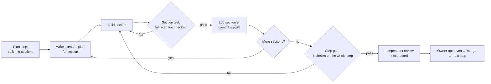

# Testing, logging and scoring process

How every piece of work is tested, recorded and scored. The rules here are mandatory; `CLAUDE.md`
summarises them. The aim: nothing untested is ever left behind, every result is provable, and
the quality score comes from evidence, not from the author's opinion.

---

## 1. Two levels of testing



### Level 1: section test (after every section)

A **step** is split into **sections** at its start (usually its roadmap checklist items, grouped
where they belong together). The sections are listed in the step's report.

- A section is finished only when its scenario checklist (§2) passes in CI.
- **Never start the next section while the current one is untested.**
- After a section passes: update the section log in the report, commit and push.

### Level 2: step gate (when all sections are done)

The whole step is retested together, on the real stack: every section's scenarios again, plus
how the sections work with each other and with all earlier steps. This is the five-check gate
(§4). Only a PASS, plus the owner's approval, lets the next step start.

### Session rule (stopping mid-step)

Work can stop at any time: end of day, a new chat, out of capacity. So **before a session ends**:

1. Every finished section is tested, committed, pushed and marked ✅ in the section log.
2. Unfinished work is either committed on the branch and marked 🔄 with a one-line note on
   what is left, or discarded. Never left untested and unmarked.
3. The next session starts by reading the section log and continues from the first section
   that isn't ✅.

---

## 2. Scenario checklist (mandatory for every section)

Test as **the most experienced tester and a doubtful senior engineer**: assume the code is
broken and try to prove it. Every category below is either covered by scenarios or marked
**N/A with a reason**. An empty category without a reason fails the section.

| # | Category | Ask |
| --- | --- | --- |
| C1 | Happy path | Does the normal use work, end to end? |
| C2 | Invalid input | Empty, missing, wrong type, too long, special characters, Unicode, malformed JSON? |
| C3 | Boundaries | Exactly at each limit, one below, one above (lengths, counts, expiry times)? |
| C4 | Authentication | No token, malformed token, expired token, revoked token, token of a deleted user? |
| C5 | Authorization | Every role against the feature: allowed and denied. Another organization's data (expect 404). Guessed ids? |
| C6 | Security abuse | Injection, enumeration (does the response reveal if an email exists?), replay, brute force, leaking secrets in responses or logs? |
| C7 | Concurrency | Two identical requests at the same moment (double signup, double refresh, double accept)? |
| C8 | Repeat calls | Same request sent twice: correct result, no duplicates? |
| C9 | Dependency failure | Database or Redis down, slow or timing out: correct error, no half-done work? |
| C10 | Data integrity | After any failure, is the data consistent? Constraints enforced by the database itself? |
| C11 | Real user flow | The full journey on the real running stack (`tests/e2e/`), as a client would do it |
| C12 | Regression | All earlier tests still pass |

**Scenario ids.** Every scenario gets an id written into its test name:
`test_<step>_<section>_<n>_<what>`, e.g. `test_s3_2_04_refresh_token_reuse_revokes_family`.
User-flow scenarios live in `tests/e2e/`. The id links the plan, the test and the automatic report.

**Plan first.** The scenario plan for a section is written in the report **before** its code.
Scenarios found later are added with a note "(added during build)", which is a useful signal,
not a failure.

---

## 3. Results: automatic report + written log

**Automatic test report (proof).** Every CI run publishes:

- a summary on the run page listing every test with pass/fail, plus totals;
- downloadable artifacts: JUnit XML (every test result) and the coverage report.

The report can't drift from reality because it is generated from the actual run.

**Written log (meaning).** In `docs/milestones/step-<n>.md`, a human-readable record of:

- the section log: status of each section;
- the scenario plan per section, by checklist category, with totals passed / failed / fixed;
- the **failure log**: every failure found while building or testing (CI failures, gate
  findings, review findings), its cause, and its fix. Failures are never hidden; they are the
  most useful part of the record;
- the link to the CI run whose automatic report proves the numbers.

---

## 4. Step gate: five checks

| # | Check | Question | Evidence |
| --- | --- | --- | --- |
| 1 | Automated | Builds, lints, type-checks, all tests pass, coverage ≥ 90 %? | Green CI run + automatic report |
| 2 | Tester | Every section's scenario checklist complete and passing? | Scenario tables in the report |
| 3 | User | Full journeys work on the real stack? | `tests/e2e/` + operator scenarios in the Compose CI job |
| 4 | Cross-check vs old code | Kept what was right, fixed what was wrong, dropped nothing by accident? | Table vs `main` @ `209a9bd` |
| 5 | Independent review | Would a doubtful senior engineer sign it off? | Output of the `milestone-reviewer` agent (`.claude/agents/milestone-reviewer.md`): findings, verdict, scorecard |

- Every check is **PASS** or **FAIL**; no "mostly".
- Any *high* or *critical* finding is an automatic FAIL.
- On FAIL: fix, re-run, update the report and the failure log.

---

## 5. Scorecard

Scored by the **independent reviewer**, never by the author, against the same nine areas used
to review the old code, so old and new are directly comparable.

| Area | What a 10 means |
| --- | --- |
| Folder structure & architecture | Layers per `docs/ARCHITECTURE.md`, one-way dependencies, nothing misplaced, no dead code |
| API design | Typed, consistent, documented, paginated, correct status codes, stable error codes |
| Database schema | Constraints, indexes for every query, migrations up/down, timezone-aware, tenant-safe |
| Scalability & load balancing | Stateless, non-blocking, bounded resources, meets performance targets |
| DSA / algorithms | Right data structures, no N+1, no O(n) where O(1) is possible, correct under concurrency |
| Code quality & correctness | No known bugs, clear names, short functions, specific error handling |
| Duplication & reuse | Each concern implemented once and reused; no copy-paste |
| Maintainability | Tests, CI, types, docs and dependencies all in order |
| Security | Meets the step's ASVS items; no secrets leak; attack cases tested |

**Rules**

- Each score has **one line of evidence** (a file, a test, a CI link or a finding).
- Areas the step hasn't built yet are **"not built yet"**, not a number. No inflated early scores.
- A step is production-grade when every area it touches scores ≥ 9, or a lower score is
  explained and accepted by the owner.
- After each step, `docs/milestones/SCORECARD.md` is updated: project-wide score per area, the
  old code's baseline beside it, and the trend.

---

## 6. Report template

Copy into `docs/milestones/step-<n>.md` at the **start** of the step and fill it in as you go.

```markdown
# Milestone <n>: <title>

- PR: <link>
- Latest CI run (automatic report): <link>
- Verdict: IN PROGRESS | PASS | FAIL

## Section log
| # | Section | Status | Scenarios (pass / total) | Notes |
| <n>.1 | ... | ⬜ / 🔄 / ✅ | 0 / 0 | |

## Scenario plan and results
### Section <n>.1: <name>
| Id | Category | Scenario | Expected | Result |
(every category C1–C12 present, or "N/A — reason")

## Failure log
| # | Found by | What failed | Cause | Fix | Status |

## Gate (when all sections are ✅)
### 1. Automated — PASS | FAIL
### 2. Tester — PASS | FAIL
### 3. User — PASS | FAIL
### 4. Cross-check vs old code — PASS | FAIL
### 5. Independent review — PASS | FAIL

## Scorecard (by the independent reviewer)
| Area | Old code | This step | Evidence |

## Carried forward
```
